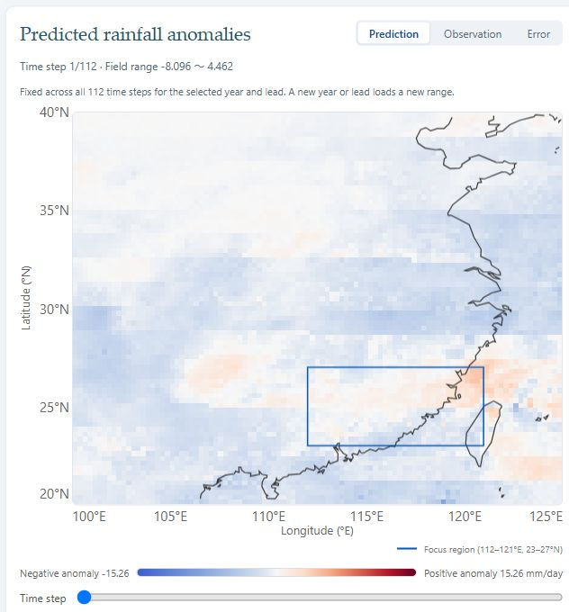
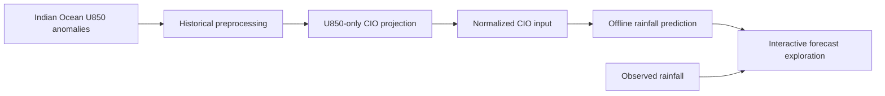

# CIO-RainCast

**An interactive demonstration of CIO-driven intraseasonal rainfall prediction over East Asia.**

CIO-RainCast connects Central Indian Ocean (CIO) projection diagnostics to machine-learning rainfall forecasts. Users can explore the U850 input fields, projected CIO series, normalized inputs, spatial forecast skill, and prediction–observation differences for a selected year and forecast lead.

**Live demo:** <https://lvad0522.github.io/CIO-RainCast/> — a static build with all 400 year × lead combinations pre-baked; the opening case (2000, 20-day lead) is complete inside the site itself and the remaining heavy payloads stream from a companion Hugging Face dataset, so no installation or backend is required (see [Static demo site](docs/deployment.md#static-demo-site)).

This repository contains the demonstration application for an ongoing research project. The current interface serves precomputed **ASTGRN** rainfall products and compares them with CIO-input **LSTM** and **STDN** products. The ASTGRN training pipeline and research datasets are maintained separately. No WSDM acceptance or publication is claimed.

## Features

- **Inspect the predictor:** raw U850 anomalies, preprocessed fields, daily grid contributions, projection closure, and a reference EOF1 map.
- **Follow the prediction workflow:** projected CIO time series and the normalized 112-step input window.
- **Explore rainfall forecasts:** grid-point correlations, linked time series, and Prediction / Observation / Error maps.
- **Compare methods:** LSTM, ASTGRN, and STDN correlations across forecast leads, regional RMSE and MAE, and CSV exports. Distinct colors identify the three solid curves.
- **Compare dates consistently:** the rainfall color scale stays fixed over the selected 112-step window and is recomputed when the year or lead changes.



## Workflow



The default page loads completed projection artifacts and historical predictions. Changing a year or lead selects another prepared case; it does not retrain a model or launch online ASTGRN inference.

| Component | Coverage |
| --- | --- |
| CIO input domain | 20°S–20°N, 40°E–120°E; 41 × 81 grid |
| Rainfall output domain | 20–40°N, 100–125°E; 81 × 101 grid |
| Target years | 2000–2019 |
| Forecast leads | 1–20 days |
| Evaluation window | 112 samples per year and lead |
| Focus region | 23–27°N, 112–121°E |

## Quick start

Requirements: **Python 3.11+**, **Node.js 22.12+** (Node 24 recommended), and npm. Historical exploration does not require a GPU.

```bash
git clone https://github.com/lvad0522/CIO-RainCast.git
cd CIO-RainCast
python -m venv .venv
```

Activate the environment with `source .venv/bin/activate` on Linux/macOS or `.venv\Scripts\Activate.ps1` in PowerShell. Then install dependencies:

```bash
python -m pip install -r backend/requirements.txt
cd frontend
npm ci
cd ..
```

**Research assets are supplied separately.** A checkout contains the application and tests, but cannot display the historical results until the required data and projection artifacts are installed. Follow [Data setup](docs/data-setup.md), then check a case:

```bash
python scripts/check_assets.py --year 2001 --lead 1
python start.py
```

Open **http://localhost:5173/**. The backend runs at **http://127.0.0.1:8000/** and API documentation is available at **http://127.0.0.1:8000/docs**. Use `python start.py --frontend-port 5177 --backend-port 8002` for different ports.

To run the services separately:

```bash
# Terminal 1
cd backend
python -m uvicorn main:app --host 127.0.0.1 --port 8000

# Terminal 2, from the repository root
cd frontend
npm run dev -- --host 127.0.0.1 --port 5173 --strictPort
```

The frontend development server proxies `/api` to port 8000. See [Deployment](docs/deployment.md) for other API addresses and production builds.

## Try the demo

1. Choose a forecast year and lead, then select **Explore results**.
2. Move the projection-date slider to inspect U850 fields and their CIO contributions.
3. Follow the projected series into the normalized input window.
4. Inspect the skill map, select a grid point, and compare its predicted and observed time series.
5. Switch between **Prediction**, **Observation**, and **Error**, or explore the LSTM–ASTGRN–STDN comparison and export its metrics.

The stored EOF1 map is a spatial reference. Projection closure checks numerical reconstruction of the CIO index; it does not establish physical causality or forecast skill. The paired model comparison evaluates stored prediction methods, rather than isolating the causal benefit of CIO inputs. Metric definitions and implementation limits are documented in [Reproducibility](docs/reproducibility.md).

## Repository structure

```text
CIO-RainCast/
├── backend/           # FastAPI routes, projection, diagnostics, and verification
├── frontend/          # React / Vite interface and local geographic assets
├── docs/              # Data, deployment, and reproducibility documentation
├── scripts/           # Asset checks, demo-data bake and upload
├── .github/workflows/ # Automated frontend and numerical checks, Pages deploy
└── start.py           # Local development launcher
```

## Development checks

```bash
python -m pip install -r backend/requirements-dev.txt
python -m pytest backend -q
cd frontend
npm run lint
npm test
```

These tests use small fixtures and do not require the research datasets. Build the frontend with an explicit API URL as described in [Deployment](docs/deployment.md).

## Related research

- Zhou et al. (2024). [Skillful Prediction of Indian Monsoon Intraseasonal Precipitation Using Central Indian Ocean Mode and Machine Learning](https://doi.org/10.1029/2024GL112308). *Geophysical Research Letters*. This is background for the CIO-based forecasting approach, rather than a publication of this East Asian demonstration.
- Zhao et al. (2024). [Adaptive Spatiotemporal Graph Recurrent Network for Sea Surface Temperature Forecasting](https://doi.org/10.1109/TGRS.2024.3502841). *IEEE Transactions on Geoscience and Remote Sensing*. The current rainfall products use an adaptation of this model family; the historical directory name `Dataset-AGCRN` is retained for compatibility.

## License and third-party assets

This private research snapshot has no assigned open-source code license. Dataset and checkpoint redistribution are handled separately. Natural Earth land data are public domain; dependency and geographic-asset attribution is listed in [Third-party assets](docs/third-party-assets.md).
