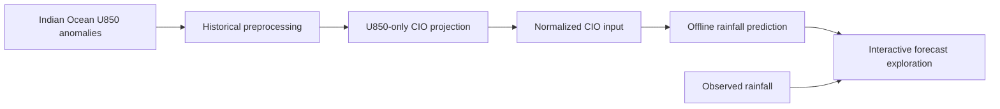

# CIO-RainCast

**An interactive demonstration of CIO-driven intraseasonal rainfall prediction over East Asia.**

CIO-RainCast connects Central Indian Ocean (CIO) projection diagnostics to machine-learning rainfall forecasts. Users can explore the U850 input fields, projected CIO series, normalized inputs, spatial forecast skill, and prediction–observation differences for a selected year and forecast lead.

**Live demo:** <https://lvad0522.github.io/CIO-RainCast/> — a static build with all 400 year × lead combinations pre-baked; the opening case (2000, 20-day lead) is complete inside the site itself and the remaining heavy payloads stream from a companion Hugging Face dataset, so no installation or backend is required (see [Static demo site](docs/deployment.md#static-demo-site)).

**Loading time:** Some rainfall and U850 panels fetch large files from Hugging Face on demand. After selecting a new year or lead, please allow time for these panels to load; the wait depends on your connection.

This repository contains the demonstration application for an ongoing research project. The current interface serves precomputed **ASTGRN** rainfall products and compares them with CIO-input **LSTM** and **STDN** products. The ASTGRN training pipeline and research datasets are maintained separately. No WSDM acceptance or publication is claimed.

## Features

- **Inspect the predictor:** raw U850 anomalies, preprocessed fields, daily grid contributions, and projection closure.
- **Follow the prediction workflow:** projected CIO time series and the normalized 112-step input window.
- **Explore rainfall forecasts:** grid-point correlations, linked time series, and Prediction / Observation / Error maps.
- **Compare methods:** switch between the focus region (default) and East Asia beside the spatial skill map. Compare annual correlations averaged over days 1–N (N = 1–20), toggle curves, and export CSV. A three-model table reports correlation, RMSE, and MAE for the selected forecast year and lead.
- **Compare dates consistently:** the rainfall color scale stays fixed over the selected 112-step window and is recomputed when the year or lead changes.


## Workflow



The default page loads completed projection artifacts and historical predictions. Changing a year or lead selects another prepared case; it does not retrain a model or launch online ASTGRN inference.

| Component | Coverage |
| --- | --- |
| CIO input domain | 20°S–20°N, 40°E–120°E; 41 × 81 grid |
| Rainfall output domain | 20–40°N, 100–125°E; 81 × 101 grid |
| Target years | 2000–2019 |
| Forecast leads | 1–20 days |
| Evaluation window | 112 samples per year and lead |
| Focus region | 23–27°N, 112–121°E |

## Quick start

```bash
git clone https://github.com/lvad0522/CIO-RainCast.git
cd CIO-RainCast
```

### Static demo

Requires **Node.js 22.12+** (Node 24 recommended) and npm. The static demo uses the prepared files included in the repository and on Hugging Face; Python, model checkpoints, and the original research datasets are not needed.

```bash
cd frontend
npm ci
```

Keep `VITE_API_BASE` and `VITE_DATA_API_BASE` unset for static mode, including in any `.env.local` or `.env.production` files.

Linux/macOS:

```bash
VITE_STATIC_MODE=1 npm run build
npm run preview -- --host 127.0.0.1 --port 4173 --strictPort
```

PowerShell:

```powershell
Remove-Item Env:VITE_API_BASE, Env:VITE_DATA_API_BASE -ErrorAction SilentlyContinue
$env:VITE_STATIC_MODE = '1'
npm run build
Remove-Item Env:VITE_STATIC_MODE
npm run preview -- --host 127.0.0.1 --port 4173 --strictPort
```

Open **http://127.0.0.1:4173/**. The default 2000 / 20-day case is included with the site. Other cases load their larger files from Hugging Face, as described in the loading note above.

### Backend mode

Requires **Python 3.11+**, Node.js, npm, and the research assets described below. Leave `VITE_STATIC_MODE` unset in this mode. From the repository root:

```bash
python -m venv .venv
```

Activate the environment with `source .venv/bin/activate` on Linux/macOS or `.venv\Scripts\Activate.ps1` in PowerShell. Then install dependencies:

```bash
python -m pip install -r backend/requirements.txt
cd frontend
npm ci
cd ..
```

**Backend mode requires research assets supplied separately.** Follow [Data setup](docs/data-setup.md) to install the forecast arrays and projection artifacts, then check a case:

```bash
python scripts/check_assets.py --year 2001 --lead 1
python start.py
```

Open **http://localhost:5173/**. The backend runs at **http://127.0.0.1:8000/** and API documentation is available at **http://127.0.0.1:8000/docs**. Use `python start.py --frontend-port 5177 --backend-port 8002` for different ports.

To run the services separately:

```bash
# Terminal 1
cd backend
python -m uvicorn main:app --host 127.0.0.1 --port 8000

# Terminal 2, from the repository root
cd frontend
npm run dev -- --host 127.0.0.1 --port 5173 --strictPort
```

The frontend development server proxies `/api` to port 8000. See [Deployment](docs/deployment.md) for other API addresses and production builds.

## Try the demo

1. Choose a forecast year and lead, then select **Explore results**.
2. Move the projection-date slider to inspect U850 fields and their CIO contributions.
3. Follow the projected series into the normalized input window.
4. Inspect the skill map, select a grid point, and compare its predicted and observed time series.
5. Switch between **Prediction**, **Observation**, and **Error** maps. Hover for a grid value, or click to keep its coordinates and value visible while changing views and dates. Error is prediction minus observation; values are in mm/day.
6. Beside **Spatial forecast skill**, select a region and the last day of the **1–N-day average** in **Annual model comparison**. Toggle series, export annual scores, and inspect the **Current selection** metrics for the forecast year and lead selected in the sidebar.

Projection closure checks numerical reconstruction of the CIO index; it does not establish physical causality or forecast skill. The paired model comparison evaluates stored prediction methods, rather than isolating the causal benefit of CIO inputs. Metric definitions and implementation limits are documented in [Reproducibility](docs/reproducibility.md).

## Repository structure

```text
CIO-RainCast/
├── backend/           # FastAPI routes, projection, diagnostics, and verification
├── frontend/          # React / Vite interface and local geographic assets
├── docs/              # Data, deployment, and reproducibility documentation
├── scripts/           # Asset checks, demo-data bake and upload
├── .github/workflows/ # Automated frontend and numerical checks, Pages deploy
└── start.py           # Local development launcher
```

## Development checks

```bash
python -m pip install -r backend/requirements-dev.txt
python -m pytest backend -q
cd frontend
npm run lint
npm test
```

These tests use small fixtures and do not require the research datasets. Production builds use `VITE_STATIC_MODE=1` for the static demo or `VITE_API_BASE` for a backend connection; see [Deployment](docs/deployment.md).

## Related research

- Zhou et al. (2024). [Skillful Prediction of Indian Monsoon Intraseasonal Precipitation Using Central Indian Ocean Mode and Machine Learning](https://doi.org/10.1029/2024GL112308). *Geophysical Research Letters*. This is background for the CIO-based forecasting approach, rather than a publication of this East Asian demonstration.
- Zhao et al. (2024). [Adaptive Spatiotemporal Graph Recurrent Network for Sea Surface Temperature Forecasting](https://doi.org/10.1109/TGRS.2024.3502841). *IEEE Transactions on Geoscience and Remote Sensing*. The current rainfall products use an adaptation of this model family; the historical directory name `Dataset-AGCRN` is retained for compatibility.

## License and third-party assets

This repository has no assigned open-source code license. Dataset and checkpoint redistribution are handled separately. Natural Earth land data are public domain; dependency and geographic-asset attribution is listed in [Third-party assets](docs/third-party-assets.md).
